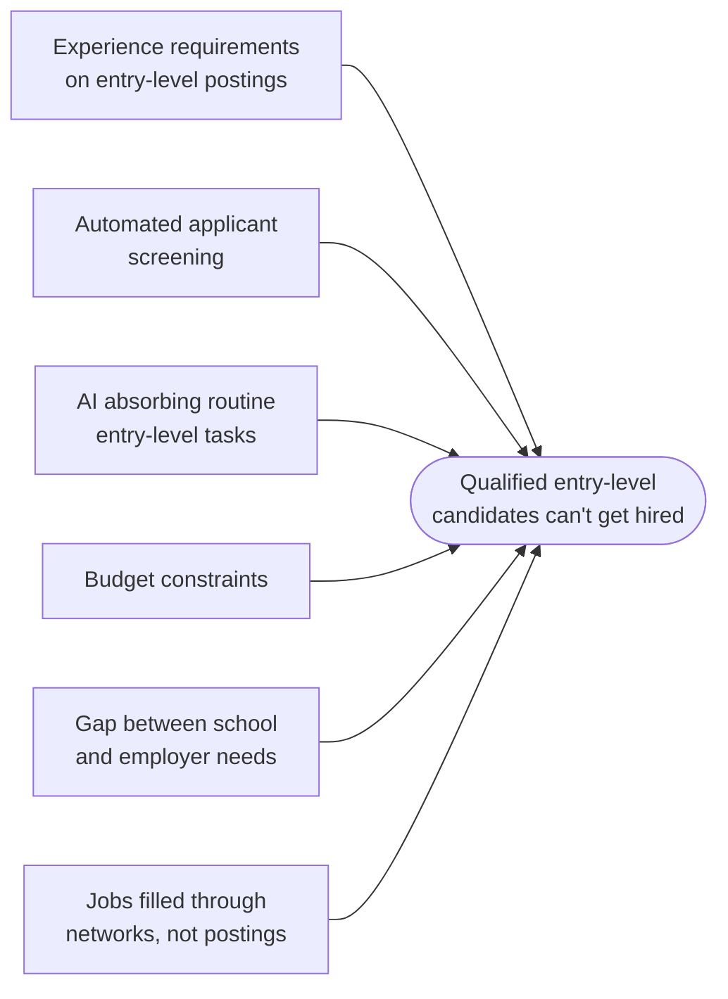

<!--
How to cite: write [@key] using a key from references.bib.
Example: [@isc2_workforce_2024] or [@bls_infosec_analysts; @cyberseek].
The reference list appears where [^ref] is, at the bottom of the page.
-->

## Problem statement

Cybersecurity is regularly described as a field with a massive worker shortage. ISC2's 2024
Cybersecurity Workforce Study estimated a global gap of 4.8 million professionals
[@isc2_workforce_2024], and ISC2's 2025 study shifted its focus to gaps in specific skills rather
than headcount [@securityinfowatch_2025].

> **Problem statement:** students preparing for cybersecurity careers are told the industry
> desperately needs them, but the traditional application pipeline (apply online, get screened, get
> hired) is breaking down, leaving qualified entry-level candidates unable to get a foot in the door.

_[Expand: why this matters to us and our classmates.]_

## Methods

_[Describe the four course methods and how they move from Problem → Idea Generation → Analysis →
Decision → Reflection. Describe the data sources and the interviews.]_

## Root-cause analysis

### Fishbone diagram

_Contributing causes of the entry-level paradox (draft; edit categories as research develops)._

### 5 Whys

1. **Why** can't qualified candidates get hired? _[answer]_
2. **Why** ...? _[answer]_
3. **Why** ...? _[answer]_
4. **Why** ...? _[answer]_
5. **Why** ...? _[root cause]_

## Divergent thinking: pathways into the field

_[List every pathway from the brainstorm without judging them: networking, referrals,
apprenticeships, help desk and IT-adjacent roles, internships, capture-the-flag competitions, home
labs, certifications, government and public sector programs, internal transfers, ...]_

## Convergent thinking: decision matrix

Each pathway is scored 1–5 on each criterion (5 is best). The weighted score is the sum of
score × weight.

| Pathway | Cost (×w) | Time (×w) | Accessibility (×w) | Worked for professionals (×w) | Weighted score |
|---|:-:|:-:|:-:|:-:|:-:|
| Networking and referrals | | | | | |
| Help desk / IT-adjacent role | | | | | |
| Apprenticeship | | | | | |
| Internship | | | | | |
| Certifications | | | | | |
| CTF competitions and home labs | | | | | |
| Government / public sector programs | | | | | |
| Internal transfer | | | | | |

_[Explain the weights and discuss the top-ranked pathways.]_

## Bias check

_[Our interviewees mostly broke into the field successfully. Discuss survivorship bias and any
other Module 02 biases, and how they limit our conclusions.]_

## Findings and recommendations

_[Summarize the root causes and the recommended pathways. Link to the [Pathways](/pathways/)
page.]_

## References

[^ref]
