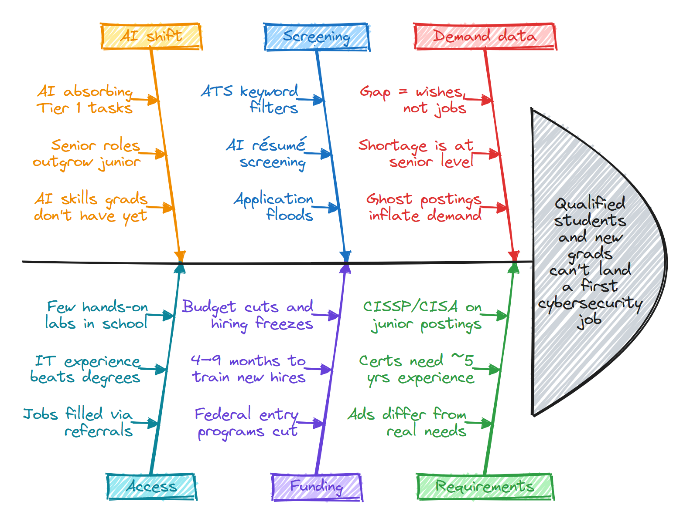

<!--
How to cite: write [@key] using a key from references.bib.
Example: [@isc2_workforce_2024] or [@bls_infosec_analysts; @cyberseek].
The reference list appears where [^ref] is, at the bottom of the page.
-->

## Problem statement

Cybersecurity is regularly described as a field with a massive worker shortage. ISC2's 2024
Cybersecurity Workforce Study estimated a global gap of 4.8 million professionals
[@isc2_workforce_2024], and ISC2's 2025 study shifted its focus to gaps in specific skills rather
than headcount [@securityinfowatch_2025].

> **Problem statement:** Students at U.S. community colleges and universities preparing for
> cybersecurity careers are told the field is short millions of workers, yet when they apply to
> entry-level postings after graduating, many can't land a first security role. About a third of
> organizations in ISC2's 2024 study had no entry-level security staff at all
> [@isc2_employers_act_2024]. As a result, graduates who have invested years of study and tuition
> are left without a starting job and questioning whether to stay in the field.

- **Who:** students and recent graduates, including Bellevue College classmates
- **What:** no first job after years of study and tuition; some leave the field
- **Where:** the U.S. entry-level cybersecurity job market
- **When:** on applying for a first security role

_[Expand: why this matters to us and our classmates.]_

## Methods

_[Describe the four course methods and how they move from Problem → Idea Generation → Analysis →
Decision → Reflection. Describe the data sources and the interviews.]_

## Root-cause analysis

### Fishbone diagram

_Contributing causes of the entry-level paradox, grouped into six categories._

### 5 Whys

1. **Why can't qualified beginners get hired?** Few entry roles exist. 31% of survey participants
   said their security teams had no entry-level professionals, and hiring managers (62% of whom had
   open roles) were focusing on mid- to advanced-level hires [@isc2_employers_act_2024].
   _(Funding, Requirements)_
2. **Why are there so few entry roles?** Teams are budget-constrained. 39% of participants named a
   lack of budget as the top reason for cybersecurity staff shortages, and 38% had experienced
   hiring freezes [@isc2_employers_act_2024]. _(Funding)_
3. **Why does budget pressure fall on beginners?** Beginners take time and money to train. 56% of
   hiring managers said entry-level staff typically need 4–9 months of training to handle tasks
   independently, and 45% spent $1,000–$4,999 to train each one [@isc2_early_career_2025]. 58% were
   concerned about attrition among entry- and junior-level staff [@isc2_hiring_trends_2025], and 52%
   of practitioners expect AI to reduce the need for entry-level staff [@isc2_ai_adoption_2025].
   _(Funding, AI shift)_
4. **Why don't employers train beginners anyway?** Fewer are trying. Just 29% of enterprises
   trained non-security staff to move into security roles, compared with 41% the year before
   [@isaca_state_2025]. The "shortage" story suggests talent can be bought ready-made.
   _(Demand data)_
5. **Why does that story persist?** The most-cited number, the 4.8 million "gap," is "not an
   estimate of current job openings" but the difference between the staff organizations say they
   need and the staff available [@isc2_employers_act_2024]. It hides that the real scarcity is
   experience: U.S. jobs asking for 2+ years of experience had only 77% of the workers they needed
   [@lightcast_q2_2024]. _(Demand data)_

## Divergent thinking: pathways into the field

_[List every pathway from the brainstorm without judging them: networking, referrals,
apprenticeships, help desk and IT-adjacent roles, internships, capture-the-flag competitions, home
labs, certifications, government and public sector programs, internal transfers, ...]_

## Convergent thinking: decision matrix

Each pathway is scored 1–5 on each criterion (5 is best). The weighted score is the sum of
score × weight.

| Pathway | Cost (×w) | Time (×w) | Accessibility (×w) | Worked for professionals (×w) | Weighted score |
|---|:-:|:-:|:-:|:-:|:-:|
| Networking and referrals | | | | | |
| Help desk / IT-adjacent role | | | | | |
| Apprenticeship | | | | | |
| Internship | | | | | |
| Certifications | | | | | |
| CTF competitions and home labs | | | | | |
| Government / public sector programs | | | | | |
| Internal transfer | | | | | |

_[Explain the weights and discuss the top-ranked pathways.]_

## Bias check

_[Our interviewees mostly broke into the field successfully. Discuss survivorship bias and any
other Module 02 biases, and how they limit our conclusions.]_

## Findings and recommendations

_[Summarize the root causes and the recommended pathways. Link to the [Pathways](/pathways/)
page.]_

### Solutions

1. **Make building experience cheaper:** Apprenticeships are a longstanding solution to shortages
   of experienced workers. IT and cybersecurity jobs are usually seen as traditional tech roles,
   even though they have more in common with the trades. Apprenticeships can make getting
   experience easier for beginners and lower the cost of hiring skilled workers by increasing how
   many are available. For example in 2022, the Federal Cybersecurity Apprenticeship Sprint led to
   over 7,000 apprentices being hired [@whitehouse_apprenticeship_2022].
   _(Funding, Requirements, Access)_
2. **Fix entry-level postings and screening filters:** Many cybersecurity positions posted require
   CISSP or CISA certifications, which are out of reach for beginners since both require about five
   years of experience [@isc2_hiring_trends_2025]. Despite this, many hiring managers still end up
   considering applicants who do not meet those high standards [@isc2_hiring_trends_2025]. Job
   postings should be updated to reflect the skill level employers actually accept.
   _(Requirements, Screening)_
3. **Solutions for students:** Get an IT-related job (help desk, network technician), lean into
   security-related tasks if available, get one well-recognized certification like CompTIA
   Security+, build hands-on proof (a portfolio, competitions, a home lab) and participate in local
   networking as much as possible (visit conferences, job fairs, etc.).
   _(Access, AI shift, Screening)_

## References

[^ref]
